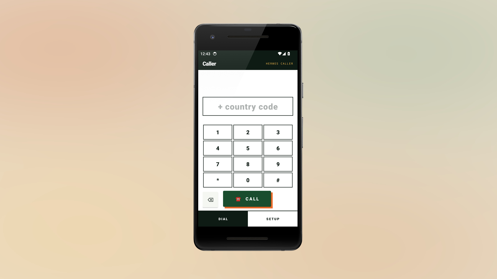

# Hermes Caller

Hermes Caller is an Android dialer and a small Python service for placing Twilio Voice calls with your own account. It grew from a founder's customer-discovery calling tool. The dialer, in-call controls and Android calling-account integration come from that app.

[Website](https://atelierneyra.com/hermes-caller) · [Download Android preview](https://github.com/latintzar/hermes-caller/releases/download/v5.8-preview/hermes-caller-v5.8-debug.apk) · [Documentation](https://docs.atelierneyra.com/hermes-caller/overview/)

The calling service stores dual-channel recordings when enabled. An opt-in transcription command retains the original Nova-3 multilingual and speaker parsing workflow. Coaching can consume its transcript files through the documented handoff; the private coach context and account-specific enrichment remain separate.




[Android device artwork credit](docs/assets/device-art-credit.md)

[View server setup](docs/images/setup.png).

## How it works

1. The Android app requests a short-lived Voice token from your server using your private access key.
2. Twilio's Android SDK connects the call. Twilio requests signed TwiML from your server, which dials the number and records both legs.
3. Twilio signs the recording callback. If recording storage is enabled, the server downloads it to your private directory using the recording SID.

You need a Twilio account, a verified caller ID or eligible number, a Voice API key, a TwiML App and an HTTPS server reachable by Twilio. Provider calls and recording may incur charges. Obtain consent and follow the recording rules that apply to your calls.

## Product workflow

Calling, recording and turning conversations into useful discovery notes involves several tools. A dedicated dialer can keep the call and its recording connected to a controlled transcription workflow.

| Feature | What it does |
| --- | --- |
| Native Android calling | Use Twilio’s Voice SDK with a short-lived token from your own server. |
| Private server setup | Configure the app’s HTTPS server and access key on the device. |
| Dual-channel recordings | Retain each call’s two channels when recording is enabled. |
| Deepgram transcripts | Run the opt-in Nova-3 multilingual and speaker parsing workflow. |
| Coaching handoff | Pass transcript files to a separately configured coaching workflow. |

The app and Python server source are published, with a downloadable debug-signed Android preview. It starts with an empty server configuration. Real calls use your account, caller identity and consent arrangements; the release documents its tested scope. Configure an owned HTTPS server and Twilio account, then validate a consented test call and optional transcription. [Product guide](docs/PROJECT.md).

## Run the server

Python 3.12 or later is recommended. Install the requirements in a virtual environment:

```sh
python -m venv .venv
. .venv/bin/activate
pip install -r server/requirements.txt
```

Set the following values in your private environment or service manager. Generate a unique random access key of at least 32 characters and keep it on your server and your own device.

| Variable | Purpose |
| --- | --- |
| `PUBLIC_BASE_URL` | Public HTTPS origin, without a path or trailing slash |
| `CALLER_ACCESS_KEY` | Private random key for the Android app |
| `TWILIO_ACCOUNT_SID` | Your Twilio account SID |
| `TWILIO_AUTH_TOKEN` | Your Twilio auth token, used to validate signatures and download recordings |
| `TWILIO_API_KEY_SID`, `TWILIO_API_KEY_SECRET` | API key pair for Voice access tokens |
| `TWILIO_TWIML_APP_SID` | SID of your TwiML App |
| `TWILIO_CALLER_ID` | Your eligible caller ID in E.164 format |
| `STORE_RECORDINGS` | Set to `1` to download completed recordings |
| `RECORDINGS_DIR` | Private directory for stored recordings, required when storage is enabled |

Run `uvicorn app:app --app-dir server --host 127.0.0.1 --port 8000` behind an HTTPS reverse proxy. Set your TwiML App's voice request URL to `https://YOUR-HOST/api/caller/twiml` with POST. The externally visible origin must match `PUBLIC_BASE_URL` exactly for signature verification. Restrict access to the host and keep the recording directory private.

## Build and configure Android

Open `android/` in Android Studio or build with JDK 17, Android SDK 34 and Gradle 8.4: `gradle -p android :app:assembleDebug`. The GitHub Actions workflow builds the same debug variant. Install your own build on your device, open **Setup**, and enter the HTTPS server origin and access key. The key is held in app-private preferences and Android backup is disabled; protect the device itself. The app requests microphone and phone permissions. Enter a destination in international E.164 format and tap Call.

Use a server and Twilio account you control. A fresh app contains no server address, access key or provider credentials. No call is made by setup or the tests.

## Transcribe a recording

Install `ffmpeg`, set `DEEPGRAM_API_KEY` privately, and run the command only when you want to send a recording to Deepgram:

```sh
python server/transcribe.py /private/recording.wav --dual-channel --output /private/transcript.json
```

Use `--dual-channel` for a genuine two-channel Twilio recording: channel 0 is the caller and channel 1 is the other party. Omit it for a mixed recording and Nova-3 diarization assigns speaker numbers without identifying people. The default language is `multi`; `CALL_RECORDER_TX_LANG` can select another supported language. Repeat `--keyterm` for known names. The command creates a new owner-only JSON file with timestamped utterances. It does not run automatically; a provider request can incur charges. Keep recordings and transcripts private. See [the transcription and coach handoff](docs/transcription.md).

## Tests

```sh
pip install -r server/requirements.txt pytest
python -m pytest -q
```

Tests use local HTTP requests and mocked recording downloads. They verify app authentication, webhook signatures and account isolation, number and SID validation, opt-in recording and the fixed download host. They also exercise Nova-3 request configuration and transcript parsing using fictional data. They do not exercise a carrier or provider account.

See [architecture](docs/architecture.md), [API](docs/api.md), and [third-party notices](THIRD_PARTY.md). Original project code is MIT licensed; dependencies keep their own terms.

[made by atelier neyra](https://atelierneyra.com)
